<!--
  Profile README for @Joylan9
  Static art lives in assets/ (rebuild: node scripts/build-static.mjs).
  Live cards are regenerated every 6h by .github/workflows/profile.yml and published to the `output` branch.
-->

<a href="https://portfolio-l3xs.vercel.app/">
  
</a>

  

  

<!-- ─────────────────────────────── 01 · ABOUT ─────────────────────────────── -->

<picture>
  <source media="(prefers-color-scheme: light)" srcset="assets/header-about-light.svg" />
  
</picture>


  I turn caffeine and curiosity into clean, scalable products — from <b>AI agent platforms</b> to <b>pixel-perfect interfaces</b>. 
  Currently exploring the intersection of <b>LLM agents and modern web engineering</b>. Reach me at <a href="mailto:joylan928@gmail.com">joylan928@gmail.com</a>.

<!-- ───────────────────────────── 02 · SERVICES ────────────────────────────── -->

<picture>
  <source media="(prefers-color-scheme: light)" srcset="assets/header-services-light.svg" />
  
</picture>

<a href="mailto:joylan928@gmail.com?subject=Project%20inquiry"></a>
<a href="mailto:joylan928@gmail.com?subject=Project%20inquiry"></a>
<a href="mailto:joylan928@gmail.com?subject=Project%20inquiry"></a>
<a href="mailto:joylan928@gmail.com?subject=Project%20inquiry"></a>
<a href="mailto:joylan928@gmail.com?subject=Project%20inquiry"></a>
<a href="mailto:joylan928@gmail.com?subject=Project%20inquiry"></a>


<a href="mailto:joylan928@gmail.com?subject=Project%20inquiry"></a>

<!-- ───────────────────────────── 03 · TECH STACK ───────────────────────────── -->

<picture>
  <source media="(prefers-color-scheme: light)" srcset="assets/header-stack-light.svg" />
  
</picture>

<!-- ──────────────────────────── 04 · FEATURED WORK ─────────────────────────── -->

<picture>
  <source media="(prefers-color-scheme: light)" srcset="assets/header-work-light.svg" />
  
</picture>

<!-- Auto-synced with my pinned repositories by .github/workflows/profile.yml -->
<!-- PROJECTS:START -->

<!-- PROJECTS:END -->

  <a href="https://github.com/Joylan9?tab=repositories"><b>Browse all repositories →</b></a>

<!-- ─────────────────────────── 05 · GITHUB UNIVERSE ────────────────────────── -->

<picture>
  <source media="(prefers-color-scheme: light)" srcset="assets/header-stats-light.svg" />
  
</picture>

<picture>
  <source media="(prefers-color-scheme: dark)" srcset="https://raw.githubusercontent.com/Joylan9/Joylan9/output/github-snake-dark.svg" />
  <source media="(prefers-color-scheme: light)" srcset="https://raw.githubusercontent.com/Joylan9/Joylan9/output/github-snake.svg" />
  
</picture>

<!-- ──────────────────────────── 06 · ACHIEVEMENTS ──────────────────────────── -->

<picture>
  <source media="(prefers-color-scheme: light)" srcset="assets/header-badges-light.svg" />
  
</picture>

  

<!-- ────────────────────────────── 07 · CONNECT ─────────────────────────────── -->

<picture>
  <source media="(prefers-color-scheme: light)" srcset="assets/header-connect-light.svg" />
  
</picture>

<a href="mailto:joylan928@gmail.com?subject=Project%20inquiry"></a>

  
  
  
  
  
  
  

